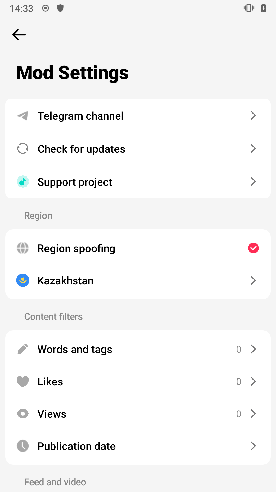
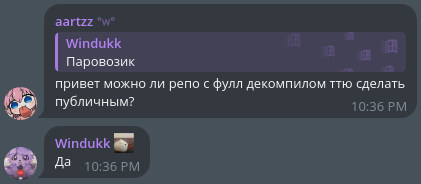

## tiktokyou (reversed)
i decompiled and made the code (almost) readable and compilable :)

made in 2 days with deepseek v4.1 flash & gemini 3.8 flash

### modifications i made after finishing src recovery
- bypassed anti-tamper & signature verification
- fixed app icon rendering bugs
- fixed runtime crashes and hook constructor issues

### guide
0. if you want update tiktokyou sources, run `./gradlew extract TikTok_You*.apk`
1. download vanilla tiktok apk from apkmirror/apkpure.. _(if the TikTok You apk you downloaded is based on 46.8.3, download 46.8.3 (arm7+arm8 ver!!!))_
2. run `./gradlew libGen com.zhiliaoapp.musically*.apk`, it'll generate `tiktok.jar` in `libs/`
3. run `./gradlew supportJar` to compile the support layer (stable hooks, HookBridge, etc.) — dependencies fetched from Maven automatically
4. run `./gradlew buildDex`, it'll build the mod, output will be in `build/mod`
5. and finally run `./gradlew patch com.zhiliaoapp.musically*.apk` to patch vanilla tiktok

### run status
it boots! tested on ASUS Zenfone 3 (2017), Android 9

### before calling me a bad guy for "leaking" sources

tty dev approved lol

